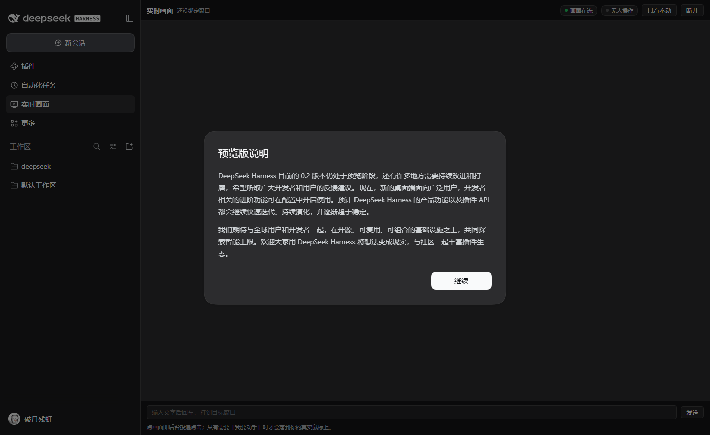

# dsh-live-screen

把「豆包电脑模式」那条闭环搬进 DeepSeek Harness，但**隔离单元换成单个窗口**：
每个目标窗口开一个工作台（独立原生宿主进程 + 控制权租约 + 逐动作回读校验），
AI 在窗口 A 里点按钮时，你可以照常操作窗口 B —— 它不抢你的鼠标、不抢你的前台窗口、不镜像自己。



## 它提供什么

| 通道 | 入口 | 用途 |
| --- | --- | --- |
| 侧边栏面板 | Harness 左侧「实时画面」图标 | 盯着 AI 干活，随时接管，看得见谁持有控制权 |
| 实时帧流 | `WS /live-screen/ws?id=<工作台>`（同源） | JPEG 帧下行 + 动作/租约上行 |
| 模型工具 | `live_screen` | `list` / `open` / `snapshot` / `act` / `lease` / `close` / `stats` |
| HTTP | `/live-screen/{stats,list,windows,workspaces,build}` 与 `/<wsId>/{snapshot,status,lease,act,open}` | 脚本 / 外部集成 |

## 架构

```
 Harness 页面 (React 面板)
   │  同源 WebSocket ── 下行 JPEG 帧 / 上行 act·lease·open
   ▼
 dsh-live-screen 宿主插件 (Node)
   │  WorkspaceManager
   ├── Workspace #1 ── ControlLease ── StateProbe(100ms)
   │      │  spawn + stdin/stdout 二进制协议
   │      ▼
   │   DesktopHost.exe (C# / .NET Framework 4.8, 首次用时本机编译)
   │      PrintWindow(PW_RENDERFULLCONTENT) → 分块哈希去重 → JPEG
   │      PostMessage 后台投递 → 失败降级 SendInput
   └── Workspace #2 …（各自独立进程，互不干扰）
```

关键取舍：

- **采集一个窗口，不是整屏。** `PrintWindow(hwnd, hdc, 0x2)` 拿到窗口自己的像素，
  所以采集不依赖它是否在前台，也不会把 Harness 页面拍进画面形成无限镜像。
- **动作先走后门。** 默认 `PostMessage`（不动光标、不抢焦点）；回读发现画面没变就
  **自动降级**重试「前台 + `SendInput`」，调用方只调一次，回执里写明走了哪一级
  （`tier: "L2"`、`degraded: true`、`l1: {tier:"L1", verified:false}`）。
  `move` / `scroll` / `focus` / `run` / `quality` 这类与像素无关的动作不降级，
  否则只会把光标抢到你脸上；`type` 走另一套规则（默认直接前台、永不重发），
  详见下面的「文字输入」一节。
- **每个动作都真回读。** 动作 → 等 `settleMs` → 再抓一帧 → 比字节；回执里 `verified`
  是实测结果，不是「写出去就算成功」。
- **控制权是租约，不是开关。** `ttlMs`（默认 2s）内 AI 持有时才能动手；你一碰真实鼠标
  或键盘，100ms 探针看到 `GetLastInputInfo` 归零立刻吊销，AI 的动作当场返回
  `preempted-by-user`，面板顶部变黄横幅提示。
- **传输同源。** `webserver.registerUpgrade()` 把原始 socket 交给插件自己的 RFC6455 实现，
  页面直接连 `ws://<harness-host>/live-screen/ws`，无 CSP、无混合内容、无额外端口。
- **零运行时依赖。** WebSocket 手写（`lib/ws.js`），图像是 JPEG，浏览器 `createImageBitmap` 解码。

## 隔离能力实测（本机 11 个窗口，`native/Probe.cs`）

| 指标 | 实测 | 结论 |
| --- | --- | --- |
| `PrintWindow` + `PW_RENDERFULLCONTENT` 黑图率 | **0 / 11**（最差 0.94 非黑像素） | 不需要 WGC，不需要 .NET 8 |
| 不带 `PW_RENDERFULLCONTENT` 的裸 `PrintWindow` | Chromium/Electron 系（Edge/QQ/计算器）**全黑** | flag 必须固定 `0x2` |
| 单次抓取耗时 | 10.5–37.7 ms（Chromium 10–13，资源管理器 33.7） | 单窗口 20fps+ 有余量 |
| `PostMessage` 后台点击成功率 | **5 / 11 ≈ 45%**（Edge/QQ/Steam 生效，记事本/资源管理器/计算器无效） | 必须实现三级降级 |

复现自己的数据：

```powershell
powershell -File scripts\build-native.ps1 -Target Probe
native\bin\Probe.exe --list
native\bin\Probe.exe --suite --out out\probe.jsonl
```

## 内存与性能（实测，Dell G15 5520 / i5-12500H / 16GB / RTX 3050 Laptop）

单窗口 418×675，20 fps 目标，JPEG q70：

| 项 | 实测 |
| --- | --- |
| Harness 宿主插件增量 | ~30 MB RSS（没有工作台时接近 0） |
| DesktopHost.exe | ~57 MB working set / ~45 MB private |
| DesktopHost.exe CPU | 空闲 ≈ 0；20fps 采集中约 0.1–0.2 个核 |
| 面板（浏览器内） | ~40 MB（与已开的 Harness 页面共享进程） |
| 单帧 | 17–19 KB（小窗口）／ 1080p 整屏 ~105 KB |
| 首帧延迟 | 4–23 ms |
| GPU 显存 | 0（JPEG 走 CPU，NVENC 未启用） |

**一个工作台约 90 MB、0.2 个核。** 没有工作台时插件本身只有几十 MB 的 Node 增量。

部署适配结论：**适合**。真正的开销是 Harness 页面本身（实测页面进程 0.6–1.6 GB，
比整套采集栈大一个数量级）。内存吃紧时把 `fps` 降到 8、`quality` 降到 55，
或者干脆不常开面板 —— 空闲 `idleMs`（默认 60s）后工作台自己关掉，进程退出。

## 安装

```powershell
# 1. 装进 profile（任选其一）
#    a) file: 依赖
cd $env:USERPROFILE\.dsh\profiles\desktop
pnpm add file:<本目录绝对路径>
#    b) 直接拷
Copy-Item -Recurse <本目录> $env:USERPROFILE\.dsh\profiles\desktop\node_modules\dsh-live-screen

# 2. 让 Loader 认识它：profile 的 package.json 里 dsh.profile.bundles 加一项 "dsh-live-screen"

# 3. 重启 Harness
```

首次打开面板（或首次调 `live_screen`）时，插件会用 `csc.exe` 把 `native/DesktopHost.cs`
编译成 `native/bin/DesktopHost.exe`，约 3–5 秒；编译失败只会让面板显示离线，不影响 Harness 启动。

预编译：

```powershell
powershell -File scripts\build-native.ps1              # DesktopHost
powershell -File scripts\build-native.ps1 -Target All  # DesktopHost + Probe
```

前提：Windows、`C:\Windows\Microsoft.NET\Framework64\v4.0.30319\csc.exe`
（.NET Framework 4.8 自带，无需 SDK、无需 Visual Studio）。

## 验证

四个自检脚本，都不依赖 Harness 运行时：

```powershell
node scripts\verify-workspace.mjs  # 租约状态机 + 工作台端到端（31 项，含真窗口点击）
node scripts\verify-host.mjs       # 路由 / WS / 工具 / 动作分发 / 空闲回收
node scripts\verify-client.mjs     # slot 注册形状、渲染树、主题 token、字典完整性
node scripts\verify-ui.mjs <url>   # 真 Harness 页面：面板真的渲染出来了吗（需 Edge）
```

`verify-workspace.mjs` 会真的启动 `DesktopHost.exe`、绑定一个可见窗口、点一下、
比对像素，所以它是唯一需要「有交互式桌面 + 至少一个窗口」的脚本。

## 配置

`cordis.patch.yml` 里给 `live-screen` 加 config：

```yaml
- id: live-screen
  config:
    fps: 20          # 目标帧率（静态窗口不变时不会重复编码）
    quality: 70      # JPEG 质量 20–95
    idleMs: 60000    # 无 watcher 多久后关掉工作台
    leaseTtlMs: 2000 # 控制权租约时长
```

## 工具用法

```jsonc
// 1. 有哪些窗口可以绑
{ "action": "list" }

// 2. 绑一个（标题片段或 hwnd），拿到工作台 id
{ "action": "open", "window": "计算器" }
// → { "ok": true, "workspace": "ws3-qo0gl", "target": { "hwnd": "0x808d2", "width": 418, "height": 675 } }

// 3. 看一眼（返回一张 image，模型真的看到画面）
{ "action": "snapshot", "workspace": "ws3-qo0gl" }

// 4. 动手：坐标是窗口图像像素，每个动作带回读结果
{ "action": "act", "steps": [
  { "type": "click", "x": 79, "y": 541 },
  { "type": "wait",  "ms": 80 },
  { "type": "type",  "text": "1234*5678" },
  { "type": "key",   "vk": 13, "down": true },
  { "type": "key",   "vk": 13, "down": false }
] }

// 5. 收工
{ "action": "close", "workspace": "ws3-qo0gl" }
```

动作类型：`move` `click` `scroll` `type` `key` `focus` `run` `quality` `wait`。
坐标用 `snapshot` 返回图像里的像素（等于窗口坐标，含标题栏边框），面板已经换算好；
手写脚本时不要再乘缩放。

`act` 的每一步回执形如：

```json
{ "ok": true, "tier": "L2", "detail": "ok", "verified": true, "changed": 1,
  "degraded": true, "l1": { "tier": "L1", "verified": false } }
```

`tier` 说最终走了哪一级（L1 后台投递 / L2 前台 SendInput），`degraded` 说中途降过级，
`verified` 说画面到底变没变 —— 后者才是真话。计算器的数字键对 L1 完全无反应，
所以它永远以 `degraded: true` 收场；这一步不需要你手动重试。

不想降级（比如你正用着这台机器、不想被挪光标）就传 `"force": false, "degrade": false`，
或者干脆只信 L1：`"degrade": false` 时回执会老实告诉你 `verified: false`。

**文字输入（`type`）是这条规则的例外：默认直接走前台，而且永不重试。**
实测后台 `WM_CHAR` 在记事本、资源管理器、系统对话框、计算器上**全部无反应**——后台投递
文字等于什么都没做。所以 `type` 默认就落到前台 `SendInput`（`force` 视为 true），
但**一次就够，绝不补发**：UWP 窗口（计算器、照片、设置…）收到 `WM_CHAR` 后会排队等
自己的输入管线消化，此时重发 `SendInput` 会和排队中的字符叠加——实测打出过
`77777777777777727*8 = 622,222,222,221,816`。想验证后台路径可以显式传 `"force": false`，
那样回执带 `"hint": "no-visible-change"` 而不是偷偷再打一遍。
`type` 的回读等待用独立的 `typeSettleMs`（默认 700ms，比 `settleMs` 长，给排队留时间）。

## 控制权怎么协作

```
你什么都不动          → holder = ai，AI 随便动手
你碰一下鼠标/键盘      → 100ms 内 holder = user，AI 的动作立刻返回 preempted-by-user
你停手 leaseTtlMs 之后 → holder 过期变 none，AI 可再取
你点面板「交还」        → 立刻释放，不必等过期
```

面板顶栏永远显示当前 holder（AI 在操作 / 你或别人在操作 / 无人操作），
被抢占时出现黄色横条：「你动了一下，控制权已还给你。停手几秒后 AI 才能接回。」

模型被抢占时拿到的是这句话：

> 你正在操作电脑，动作已让给你；停手后再来，或先看一眼画面重新规划。

## 安全边界

- 只挂 Harness 自己的 `webServer`（默认 `127.0.0.1`），不额外开端口。
- WebSocket 走同源升级，页面以外连不上。
- 面板「只看不动」是默认：关着时点击仍会投递（你显式点了画面），键盘与文字不下发。
- `run` 走 `Process.Start` 当前用户权限，并用 Job Object（`KILL_ON_JOB_CLOSE`）把子进程
  绑到工作台上，工作台一关就跟着死，不留孤儿进程。
- 要彻底停：关面板 → 没 watcher 且超过 `idleMs` → 工作台关闭、宿主进程退出。

## 已知限制

- 只支持 Windows（`PrintWindow` + `PostMessage`/`SendInput`）。
- 一次只绑一个窗口；跨窗口流程要开多个工作台。
- 需要该窗口**已存在且未最小化**（最小化窗口 `PrintWindow` 拿不到像素）。
- 高完整性（管理员）进程的窗口会被 UIPI 拦截，动作会明确报错而不是静默失败。
- 需要交互式会话（`SESSIONNAME=Console`）。跑在服务里既抓不到窗口也投不进输入。
- 独占全屏的 D3D 游戏窗口仍可能抓到黑屏（`PrintWindow` 的限制）。

## License

MIT
